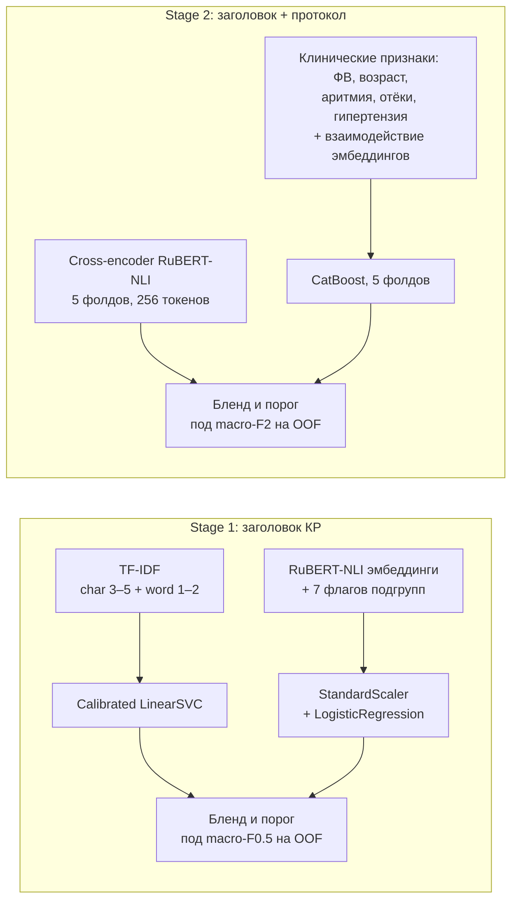

# Применимость клинических рекомендаций к протоколам осмотра

Решение медицинского кейса Сбера на **AI Journey 2026**: NLP-классификация на русском языке в две стадии. Сначала определяем, какие разделы клинических рекомендаций (КР) касаются только отдельных групп пациентов. Затем проверяем, применим ли такой раздел к конкретному протоколу осмотра.

Практический смысл — сократить контекст для LLM-проверки медкарт: вместо полного текста КР передавать только разделы, относящиеся к пациенту.

## Результат

| Подзадача | Метрика | Значение | Балл LB |
|---|---|---|---|
| Stage 1 — классификация заголовков КР | macro-F0.5 | ≈ 0.90 | 18.7 / 21 |
| Stage 2 — применимость к протоколу | macro-F2 | ≈ 0.84 | 37.0 / 49 |
| **Итого** | | | **55.7 / 70** |
| Бейзлайн организаторов (bag-of-words + LogReg) | | | ≈ 45 / 70 |

Балл получен на закрытом тесте платформы. Код решения — в [`solution.ipynb`](solution.ipynb).

## Задача

**Stage 1.** По заголовку подраздела «Лечение» (название КР и путь по иерархии разделов) определить, «Общий» он (применим ко всем пациентам с диагнозом) или «Специальный» (для отдельной группы: дети, пожилые, беременные, пациенты с сопутствующим заболеванием или особой формой болезни).
- 1 767 train / 442 test, ≈ 22% «Специальных».
- Метрика **macro-F0.5**: ошибочно назвать общий раздел специальным дороже, чем пропустить специальный.

**Stage 2.** По паре «специальный заголовок + сырой текст протокола осмотра» решить, применим ли раздел к пациенту. «Не применимо» ставится только при явном противоречии; если данных нет, раздел считается применимым.
- 690 train / 173 test, ≈ 66% «Применимо».
- Метрика **macro-F2**: пропустить применимый раздел вчетверо дороже ложной тревоги.

Итоговый балл: `70 × (0.3·M₁ + 0.7·M₂)`, где `Mᵢ = clip((macro-F − 0.5) / 0.45, 0, 1)`.

## Решение

**Stage 1.** Две модели разной природы:
- **TF-IDF + Calibrated LinearSVC.** Символьные n-граммы устойчивы к русской морфологии и медицинским сокращениям. Калибровка Платта делает выход SVC вероятностью, которую можно смешивать.
- **Эмбеддинги `cointegrated/rubert-base-cased-nli-threeway` + LogisticRegression** с 7 regex-флагами подгрупп пациентов (дети, пожилые, беременность, коморбидность, тяжёлое течение, хирургия, диагностика). Флаги кодируют прямо то, что по условию делает раздел «Специальным».

**Stage 2.** Две модели:
- **Cross-encoder** на паре `[CLS] заголовок [SEP] протокол` с early stopping по ROC-AUC внутри каждого фолда.
- **CatBoost на 1 548 признаках.** Из полного текста протокола извлекаются числовые клинические параметры: фракция выброса и возраст с медианным заполнением по train и флагами пропуска, плюс упоминания аритмии, отёков, гипертензии. К ним добавлены признаки взаимодействия эмбеддингов заголовка и протокола: косинус, расстояние, `e_t ⊙ e_p`, `|e_t − e_p|`. Числа важны, потому что многие разделы КР отсекают пациентов по порогам (возраст, ФВ при ХСН), а трансформер видит только начало протокола.

**Подбор порогов под метрику.** Обе метрики асимметричны, поэтому порог 0.5 не оптимален. Вес бленда (шаг 0.05) и порог (0.10–0.90, шаг 0.01) подбираются сеткой по OOF-предсказаниям 5-fold CV. Тест в подборе не участвует.

**Валидация.** `StratifiedKFold(5, shuffle=True, random_state=42)` для всех моделей. Большинство протоколов теста встречается в train в паре с другими заголовками, поэтому обычная стратификация ближе к распределению теста, чем группировка по пациентам.

## Стек

Python, PyTorch, Hugging Face Transformers, scikit-learn, CatBoost, pandas.

